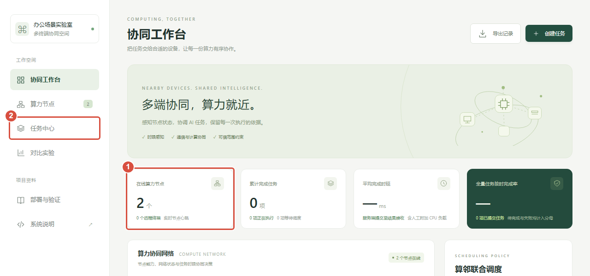
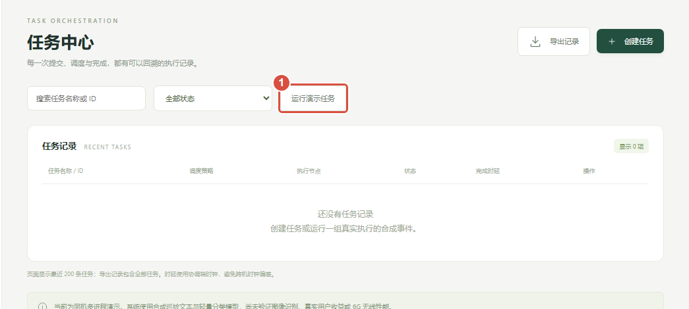
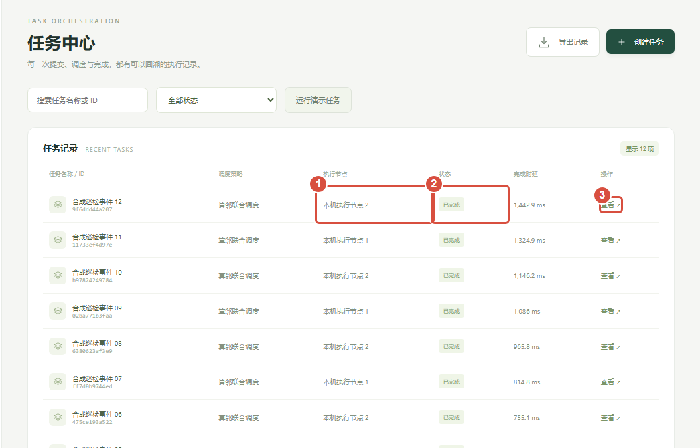
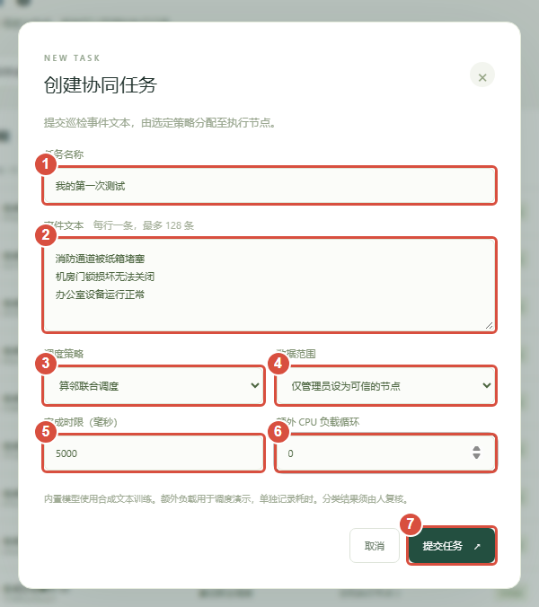
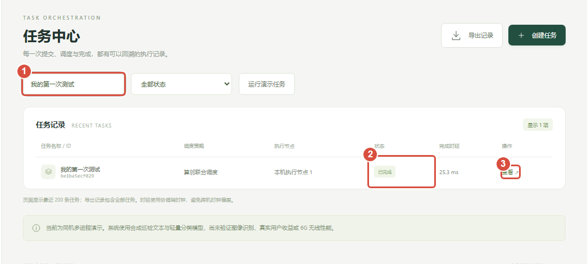
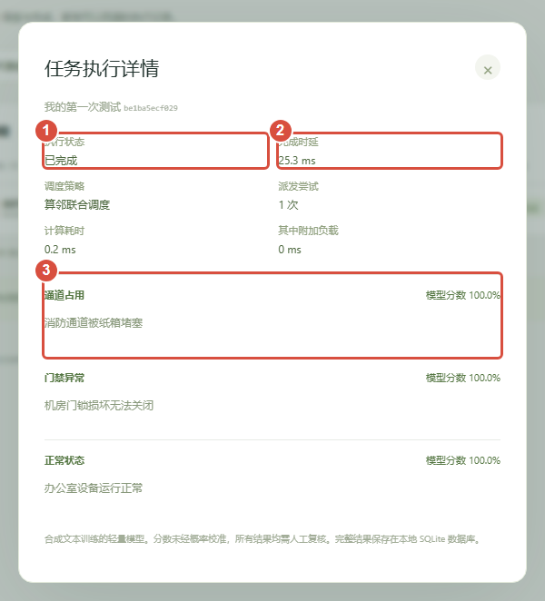
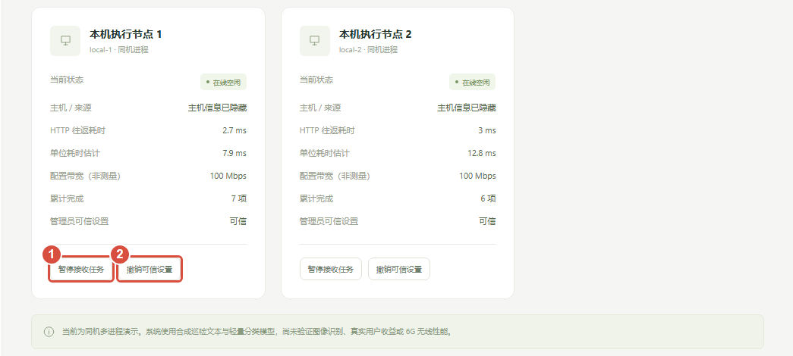
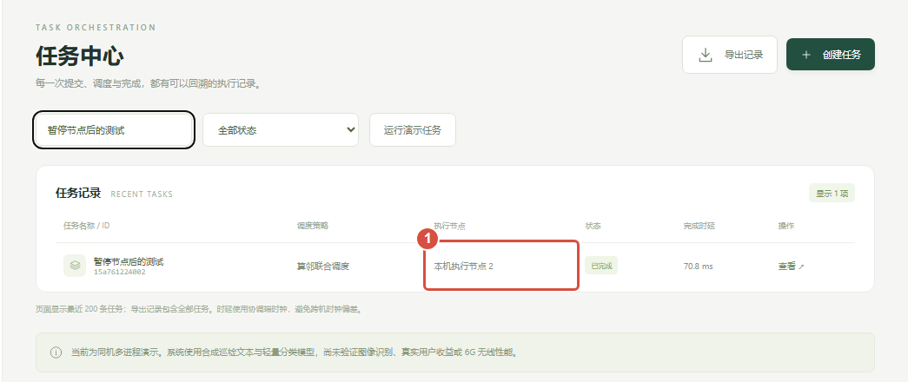
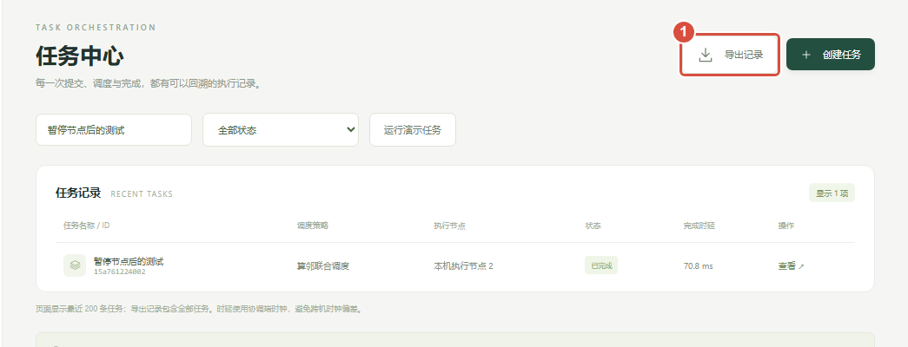
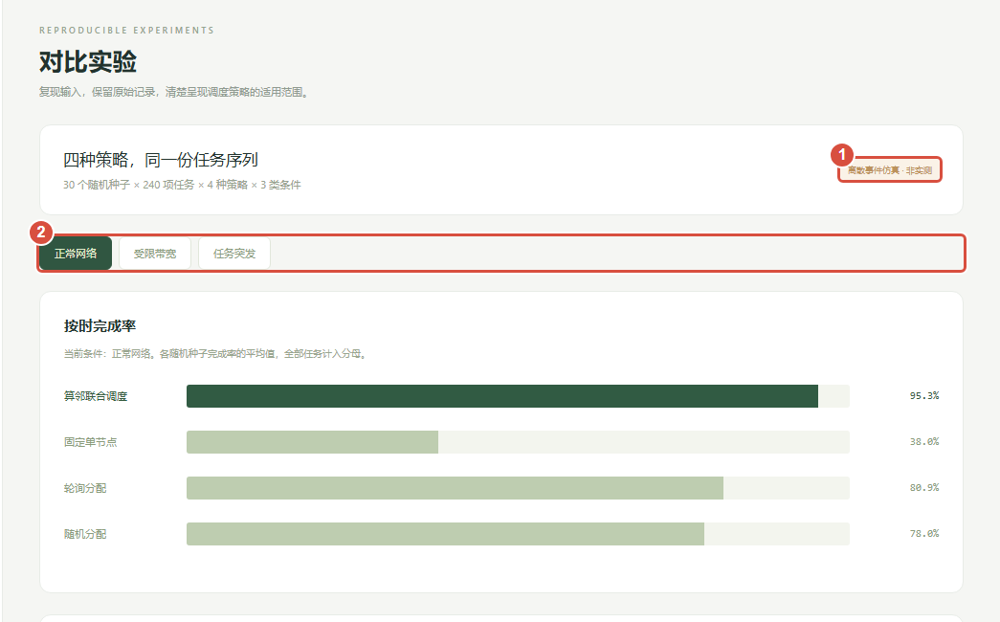

# 算邻零基础图文使用教程

先做第1至6步。截图来自独立同机教学会话；图中数字和任务记录可以与你的不同。

## 1 打开文件夹并启动平台

这份教程教你按按钮完成一次操作。先做第1至6步；暂停节点、导出和双机连接可以之后再学。

网页版每一步先向下滚动看完，再点击“下一步”。截图可以点击放大；PDF版本按页阅读。

1. 同时按键盘上的 Win 和 E，打开文件资源管理器。Win键通常带有Windows图标。
2. 点击文件资源管理器最上方的地址栏，输入下面的文件夹路径，然后按回车。

```text
D:\6G
```

在这个文件夹里找到 start.bat，双击它。如果没有显示文件后缀，可能只看到名为 start 的 Windows 批处理文件。不要双击 launch.py，也不要打开 web/index.html。

| 看到什么 | 怎么判断 |
| --- | --- |
| 弹出一个命令窗口 | 这是后台服务，请保持开着。 |
| 浏览器自动打开算邻 | 启动成功，进入第2步。 |
| 浏览器没有自动打开 | 保持命令窗口开着，按第2步手动打开网址。 |

注意：本机已经安装Python，可以直接练习。教程按项目放在D:\6G编写；如果你另存了位置，就打开实际存放start.bat的那个文件夹。

完成标志：命令窗口保持运行，没有显示“启动失败”。

## 2 打开网页，找到任务中心

1. 打开常用浏览器，例如Edge或Chrome。点击最上方的网址栏。
2. 输入下面的网址，按回车。这里输入网址，不是输入到网页搜索框。

```text
http://127.0.0.1:8765
```



| 图中标记 | 你要看什么或点击什么 |
| --- | --- |
| 1 | “在线算力节点”通常为2，表示两个后台处理程序已连接。 |
| 2 | 点击左侧“任务中心”，进入下一步。 |

注意：默认两个节点都在当前这台电脑上。节点可以先理解成“负责接任务的处理程序”。

完成标志：能看到“协同工作台”，右上角显示“协调服务在线”。

## 3 点击一次，运行现成任务

在左侧点击“任务中心”。先用现成任务熟悉流程，不需要自己填写文字。



1. 点击“运行演示任务”一次。它会提交12项独立的示例任务。
2. 等待几秒，查看下方“任务记录”。状态会从待调度到执行中，再到已完成；很快完成时，可能直接看到已完成。



注意：示例任务使用合成文字，并带有用于观察排队的额外CPU负载。它们是教学演示，不是真实办公室事件。不要连续反复点击。

完成标志：出现12项新任务，并能看到“已完成”的状态。

## 4 填写自己的第一项任务

点击页面右上角“创建任务”。弹出表单后，按下面的数字填写。



1 任务名称：我的第一次测试
2 事件文本：复制本页下方三行文字
3 调度策略：算邻联合调度
4 数据范围：保持“仅管理员设为可信的节点”
5 完成时限：5000，意思是5秒
6 额外CPU负载：0，先不增加额外计算
7 提交按钮：填好后点击“提交任务”

把下面三行完整复制到“事件文本”框，每条占一行：

```text
消防通道被纸箱堵塞
机房门锁损坏无法关闭
办公室设备运行正常
```

注意：这些是练习用的示例句子。三行文字会作为1项任务提交，由1个节点一起处理，最终返回3条分类结果。

完成标志：点击“提交任务”后，表单关闭，页面提示任务已提交。

## 5 找到刚刚提交的任务

1. 回到左侧“任务中心”。
2. 在上方搜索框中输入“我的第一次测试”。状态筛选保持“全部状态”。
3. 找到对应任务，等待状态成为“已完成”。
4. 点击这一行最右侧的“查看”。



| 这一列 | 表示什么 |
| --- | --- |
| 执行节点 | 这项任务由哪个处理程序执行。 |
| 状态 | 是否仍在等待、正在运行或已经完成。 |
| 完成时延 | 从提交到收到结果花了多久，ms表示毫秒。 |

注意：平台会保留旧任务。有旧记录很正常，不需要先清空数据库。若刚提交的任务没出现，先清空搜索条件并选择“全部状态”。

完成标志：打开名为“我的第一次测试”的任务详情弹窗。

## 6 读懂结果，完成第一次使用



| 你输入的文字 | 本次示例结果 |
| --- | --- |
| 消防通道被纸箱堵塞 | 通道占用 |
| 机房门锁损坏无法关闭 | 门禁异常 |
| 办公室设备运行正常 | 正常状态 |

看到这3条结果，说明你已经完成了提交、分配、执行和查看。点击弹窗右上角×关闭，再继续操作。

注意：先看分类名称和完成状态即可。模型分数未经校准，分数100%也不代表现实中一定判断正确。当前示例模型需要人工复核结果。

完成标志：能看到自己的任务名称、已完成状态，以及3条输入对应的分类结果。

## 7 进阶练习，暂停一个节点

先等现有任务结束。左侧点击“算力节点”，找到“本机执行节点1”。



按钮变成“恢复接收任务”，说明暂停成功。节点仍然在线，只是不再接收新任务。另一个节点保持正常接收。

1. 创建一项新任务，名称填“暂停节点后的测试”，事件文本填“办公室设备运行正常”，其余保持第4步设置。
2. 提交后在任务中心搜索这个名字，查看“执行节点”。



最后回到节点页，点击节点1的“恢复接收任务”，让两个节点都能继续接活。

注意：暂停前已经领取的任务可以继续完成。不要同时暂停所有节点，否则新任务会一直待调度。

完成标志：新任务由节点2执行，随后你已恢复节点1接收任务。

## 8 导出记录，正确关闭平台

在任务中心或工作台右上角，点击“导出记录”。浏览器会下载一个CSV文件。



1. 在浏览器下载列表找到“算邻-任务原始记录.csv”。也可以按Ctrl+J打开下载列表。
2. 用Excel、WPS或文本编辑器打开。主要查看id、name、worker_id、status、latency_ms等列。

| CSV字段 | 通俗解释 |
| --- | --- |
| name | 你填写的任务名称 |
| worker_id | 执行任务的节点编号 |
| status | completed为已完成，queued为待调度 |
| latency_ms | 任务完成时延，单位毫秒 |
| deadline_met | 是否在设置时限内完成 |

结束使用时，切回启动start.bat时弹出的命令窗口，按住Ctrl再按C，停止后台服务。关闭浏览器只是关闭页面。下次使用重新双击start.bat。

注意：导出包含历史任务，不只包含刚才的一项。不要为了获得干净截图而删除原始数据库。

完成标志：CSV已下载；按Ctrl+C后后台服务停止。

## 9 对比实验页面怎么看

点击左侧“对比实验”，可以切换正常网络、受限带宽和任务突发。



| 页面或数据 | 属于哪种记录 |
| --- | --- |
| 任务中心和导出CSV | 你通过这个平台实际提交的任务记录。 |
| 对比实验页 | 预先运行的参数化仿真；不是刚提交任务自动产生的对照。 |
| 平均时延 | 平均等待多久收到结果，通常越小越好。 |
| 按时完成率 | 在规定时限内完成的任务比例，通常越高越好。 |

注意：切换此页不会给真实电脑限速，也不会改变任务中心的已完成结果。仿真里的网络和计算参数是假设，不是实际6G性能。

完成标志：能区分自己实际提交的记录与预先生成的仿真结果。

## 10 卡住时，按现象排查

| 你看到的现象 | 先这样处理 |
| --- | --- |
| 找不到start.bat | 确认进入D:\6G。若文件后缀被隐藏，找名为start的Windows批处理文件。 |
| 网页无法访问 | 先确认start.bat的命令窗口还在运行，再输入完整网址http://127.0.0.1:8765。 |
| 提示端口已占用 | 先打开8765网址。如果已经是算邻，就使用现有页面；不要连续重复启动。 |
| 在线节点为0 | 等待几秒刷新。若仍为0，检查启动窗口是否报错，再正常停止并重启。 |
| 任务一直待调度 | 至少一个节点必须在线、未暂停接收、且设为可信。单独检查这些设置。 |
| 找不到刚提交的任务 | 清空搜索条件，将状态切回“全部状态”，再搜索你自己填写的任务名称。 |
| 同一任务出现3条结果 | 因为你在一个表单中输入了3行，它们属于同一项任务。这是正常行为。 |
| 看见接入令牌登录框 | 本机练习请用127.0.0.1网址。远程浏览器访问需使用当前协调端的接入令牌。 |
| 命令窗口提示找不到python | 当前开发机已安装Python；若换到其他电脑，需要先安装Python 3.10或更高版本。 |

如果8765确实被其他程序使用，可以在项目文件夹地址栏输入powershell并按回车，再粘贴下面命令并按回车：

```text
python launch.py --port 8766
```

随后浏览器改用 http://127.0.0.1:8766。仍卡住时，保留启动窗口的完整报错，并记录你停在教程哪一步。

完成标志：能根据现象找到下一项检查，不需要修改代码或删除数据。

## 11 可选，准备第二台真实电脑

前面的截图使用1台电脑上的2个处理程序。下面才是两台物理电脑的连接方法。第一次练习可以暂时跳过。

1. 把当前电脑称为A，另一台称为B。两台连接同一个可信局域网。
2. A先用Ctrl+C关闭之前的算邻后台。
3. 在A的D:\6G文件夹地址栏输入powershell，按回车，打开当前目录的终端。
4. 粘贴下面命令并按回车，保持窗口开着。

```text
python launch.py --host 0.0.0.0 --workers 1
```

这会在A启动协调服务和1个本机执行程序。A仍通过http://127.0.0.1:8765使用网页。

另开终端，运行以下命令，找到当前连接网卡的IPv4地址并记下来：

```text
ipconfig
```

下面以192.168.1.100为示例，实际必须换成A的地址。把更新后的项目包解压到B，找到有launch.py的那层文件夹。B需要Python 3.10或以上。

把A的D:\6G\.local\access_token文件通过可信方式复制到B的项目目录，改名为token.txt。复制文件本身即可，不用把令牌写进命令。

注意：令牌只供连接设备使用，不放进公开文件、截图或网盘。此页使用默认.local数据目录；如果你自己另设了数据目录，以实际目录中的access_token为准。

完成标志：A的服务保持运行；你已记下A的真实IP；B有项目文件和token.txt。

## 12 可选，接入B并确认真实执行

在B的项目文件夹地址栏输入powershell并按回车。将下面命令中的示例IP替换成A的真实IP，再整行粘贴运行：

```text
python -m suanlin.worker --coordinator http://192.168.1.100:8765 --token-file token.txt --name 办公室电脑B --id office-b
```

1. 保持B的执行端窗口开着，回到A的网页“算力节点”。
2. 找到“办公室电脑B”，核对后点击“设为可信”。远程端默认不可信。
3. 确认A和B都在线、未暂停接收。旧的离线记录可以保留。
4. 回任务中心点击运行演示任务，再检查执行节点列是否出现办公室电脑B。

| 检查项 | 怎样才算完成 |
| --- | --- |
| 设备真的不同 | A、B是两台物理电脑，不能把两个程序当两台电脑。 |
| 连接成功 | A的节点页显示B在线。 |
| 可以处理默认任务 | B已设为可信，并接收任务。 |
| 确实承担工作 | 任务记录中出现B作为执行节点。只显示在线还不够。 |

如果本批任务没有分到B，可创建数项独立任务，将策略改为“轮询分配”，分别提交，再查看执行节点。不要把多行文字误当成多项独立任务。

注意：连接失败时检查IP、网络和A的专用网络防火墙许可。部分访客或校园Wi-Fi会隔离终端，可改用你们有权管理的可信实验网络；不需要关闭整个防火墙。

需要正式收集双机、需求和模型证据时，再阅读docs/现场取证操作手册.md。日常使用先完成前6步即可。

完成标志：A显示B在线，而且你找到至少一项确实由B处理完成的任务。
